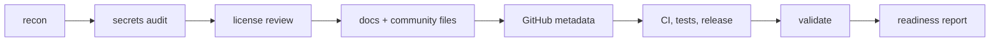

# Open Source Ready

Orchestrates three installed skills instead of repeating them. Read a child skill only when its step is reached.

| Child skill | Path | Owns |
|---|---|---|
| `open-sourcing` (Trail of Bits) | `.agents/skills/open-sourcing/` | secrets audit, license review, readiness checklist, per-language references, CI and release checks |
| `repository-documentation` (JanSzewczyk) | `.agents/skills/repository-documentation/` | README templates, GitHub description, topics, badges, metadata rules |
| `github-repo-publisher` (MJWNA) | `.agents/skills/github-repo-publisher/` | community files, issue/PR templates, `.repo-publisher.yml`, security settings, gh commands, release mode |



## Modes

- `dry-run` (default when the user has not said "apply", "write" or "publish"): read-only. Run scans and checks, print the audit, list proposed file changes and their diffs. Write nothing.
- `apply`: write or improve files after showing each diff. Remote changes stay gated (see Approvals).

Say the mode and the detected stack back before writing anything.

## Gates that override the child skills

1. **Never** create/push a repository, change visibility, apply branch protection, set secrets scanning, push tags, or call `gh` mutations without explicit user approval. On approval, use `github-repo-publisher` "Release Mode" / `references/gh-command-reference.md` and verify with read-back.
2. **Never** choose or replace a license. Present options with `open-sourcing/references/licensing.md` and ask.
3. **Never** invent commands, features, versions, badges or test results. Run a command or omit it.
4. Preserve existing docs. Read each target file first; overwrite only with a shown diff, and keep user-specific sections verbatim.
5. `repository-documentation` Step 9b auto-updates GitHub: skip it. Mirror its output into the report for approval instead.
6. `open-sourcing` Step 1 org detection is Trail of Bits–specific; for other orgs take the `generic` path and skip `references/trailofbits.md`.

Tie-break order when children disagree: safety gates above > step order below > child internal step order.

## Workflow

1. **Recon.** `git status`, `git remote -v`, `git branch --show-current`, `git log -1`. Read `AGENTS.md`/`CLAUDE.md` chain, build files (`Cargo.toml`, `package.json`, lockfiles), CI workflows. State language, frameworks, dependency set, entry points, and the repo's own check command.
2. **Secrets and sensitive data.** Follow `open-sourcing` Step 2 first: `bash .agents/skills/open-sourcing/scripts/check_readiness.sh`, then `bash .agents/skills/github-repo-publisher/scripts/secret-preflight.sh .`. If `gitleaks`/`trufflehog` are not on `PATH`, ask before installing one and fall back to `git log -p --all` plus a marker grep. Report ever-committed secrets as a stop-the-release finding.
   - The preflight filename scan is a hit list, not a verdict: source files named `*token*` (`crates/proxy/src/tokens.rs`), `node_modules/`, and agent worktree copies all match. Re-check each hit by reading it before reporting.
   - When its content scan prints `rg not installed; skipped`, the repo is unverified, not clean. Run the equivalent grep yourself, excluding `node_modules`, `target`, `.git`, and any `.claude/worktrees` copy; the scanner's own regex lines match their own grep.
3. **License review.** Detect existing `LICENSE`/`COPYING` and manifest fields. Report a decision (missing, inconsistent, incompatible dependency licenses if `cargo deny` reports them). Ask; do not choose. A manifest declaring `license = "MIT OR Apache-2.0"` with no license files is a state to report: a dual claim needs both file bodies, and adding one is a license decision.
4. **README.** Detect the project type with `repository-documentation/references/detection-rules.md`, pick the closest `templates/`, and merge with the existing README per its Step 5. Installation and usage instructions must be commands that run in this repo (use its real build layout, for example `cargo build --release`, `bun install` in `web/`). Verify every command you print at least once, or mark it unverified and say why.
5. **Community files.** Create or improve `CONTRIBUTING.md`, `CODE_OF_CONDUCT.md`, `SECURITY.md`, `SUPPORT.md` from `github-repo-publisher/templates/` and its `CONTRIBUTING.md`/`SECURITY.md`/`SUPPORT.md` exemplars. Fill in real project facts (check command, discussion route, supported versions); no placeholder text.
6. **Templates.** `github-repo-publisher/templates/` for `.github/ISSUE_TEMPLATE/{bug_report,feature_request,config}.yml` and `.github/pull_request_template.md`. Keep the repository's own check command in the PR template.
7. **Description.** One line from `repository-documentation/references/github-metadata.md`. Plain-English value plus technical category. No marketing superlatives, no unverified claims.
8. **Topics.** 10–20 lowercase hyphenated topics derived only from what the code shows: languages, frameworks, runtime, protocols, domain, integrations, distribution. Print each with the file evidence that justifies it. Reject generic filler (`open-source`, `tools`, `software`).
9. **Beginner contributions.** Read the issue tracker if reachable (`gh issue list`), then propose 3–5 concrete tasks that touch a real code path, with file paths and acceptance notes, plus which to label `good first issue` or `help wanted`. Do not create issues without approval.
10. **CI, tests, dependencies, release.** Inspect `.github/workflows`, the repo check command, `dependabot.yml`, and release/tag state. Use `open-sourcing` Steps 6 and 8, `github-repo-publisher/references/release-workflows.md`, and the language reference (`open-sourcing/references/rust.md`, `javascript.md`, `python.md`, ...). Report missing jobs and unreleased tags rather than assuming.
11. **Validate.** Run the repository's check command and any link checker available. Verify internal doc links resolve, YAML parses (`python3 -c 'import yaml,sys; ...'` or a parser that exists), and the README commands exist. Record exact exit status; never invent a pass.
12. **Report.** Print the report in chat (structure below). Write it to a file only if asked, at `.oss-ready/report.md`, which must be gitignored.

## Report structure

```markdown
# Open-source readiness — <repo> @ <sha>
Mode: dry-run | apply
Stack: <languages, frameworks, build>
Done: <steps completed, each with evidence (command, exit status, path)>
Proposed changes: <file → one-line intent>
License: <state, decision needed>
Topics: <list with evidence>
Beginner issues: <list>
Blocked / needs approval: <remote writes, license, history rewrite, dependency installs>
Risks: <secrets ever committed, missing tests, no CI, stale release>
```

## Re-running

Every step is a re-check, not a rewrite: read current file state, diff against the ideal, and only touch what is materially wrong. Placeholder or one-line files are fair game; substantial existing content is not. A second run on an unchanged repo must report no changes.

## Tools

- Prefer `gh` for reads (`gh repo view --json`, `gh issue list`). Mutations need approval.
- With no `rg`/`jq` on `PATH`, scan with `grep -rInE` and `find`, and parse with `python3` through the `execute` tool (`yaml.safe_load`), never `python3 -c` through `bash`.
- `rsync` may be absent: install a vendored skill folder with `cp -r <src>/. <dest>/` then `rm -rf <dest>/.git`.
- Diagrams: Mermaid in fenced code blocks. GitHub renders it, it needs no install, and it diffs. Use another renderer only if the user asks.
