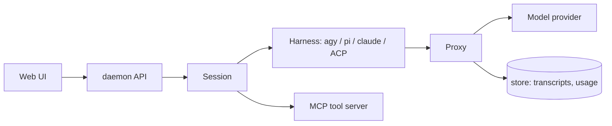

<div align="center">


# 🔥 emberloop-rs

[](https://github.com/ciokyyy/emberloop-rs/actions/workflows/ci.yml)
[](https://github.com/ciokyyy/emberloop-rs/releases/latest)
[](https://www.rust-lang.org/)
[](LICENSE-APACHE)
[](https://github.com/ciokyyy/emberloop-rs/stargazers)

**Run coding-agent Sessions from a local daemon, with one proxy that owns the model wire.**

[Features](#-features) • [Architecture](#-architecture) • [Getting Started](#-getting-started) • [CLI & Usage](#-cli--usage) • [Development](#-development)

</div>

---

## 👋 Overview

`emberloop-rs` is the Rust implementation of Emberloop. A single local daemon serves an embedded SvelteKit UI on loopback, runs coding-agent Sessions through pluggable harnesses, and proxies every model request so context compression, steering, tool policy, and usage metering happen in one place instead of in each harness.

Every capability is owned by one crate, so a behaviour is declared once and shared by every harness instead of being re-implemented per agent.

> **Status:** Pre-1.0. CLI flags, the HTTP API, and the on-disk layout change between releases. A tag is a snapshot, not a stability promise; pin one if you need the layout to stay put.

---

## 📖 Table of Contents

- [👋 Overview](#-overview)
- [✨ Features](#-features)
- [🧱 Architecture](#-architecture)
- [🎯 Getting Started](#-getting-started)
- [🚀 CLI & Usage](#-cli--usage)
- [🔧 Configuration](#-configuration)
- [🔄 Upgrading](#-upgrading)
- [💻 Development](#-development)
- [📁 Project Structure](#-project-structure)
- [🤝 Contributing](#-contributing)
- [📜 License](#-license)
- [📧 Support & Security](#-support--security)

---

## ✨ Features

### 🔌 Model-Wire Proxy (`crates/proxy`)

- **Multi-wire translation** — Speaks Google, OpenAI Chat Completions, OpenAI Responses, and Anthropic wire formats, translating each conversation into a neutral core turn list and writing system/developer items back byte-for-byte
- **Billion-context conversation folding** — Declares and executes `compress`, `decompress`, `search_context`, and `acp_status` directly on the wire so proxy turns stay hidden from harnesses, backed by a persisted nudge state machine (`first`, `pressure`, `emergency`, `tier2`, `tier3`), a preflight overflow backstop, and `ctx:` spill replacement for oversized tool results
- **Byte-identical steering & carry** — Re-attaches queued steers as splices keyed to their anchor turns without breaking thought signatures, and sanitizes stored history when switching harnesses or models mid-Session
- **Prompt pinning & usage metering** — Pins model-facing policy and tool descriptions per Session from `crates/prompts` (with `<config-root>/prompts/<id>.md` overrides) and records per-request input usage and prompt-cache hit rates

### 🔧 MCP Tool Server (`crates/tools`)

- **Files & search** — Serves `read` (line-numbered views, range paging, `:raw`, images, `ctx:` handles, `el://skills/<name>`, `el://docs/<topic>`), hashline `edit` (including multi-file patches), `write`, project-jailed `grep` and `find`
- **Shell, background & persistent Python REPL** — Runs `bash` (with automatic `rtk` rewrite when installed, sourced `$EMBERLOOP_ENV_FILE`, and browser resolution for `agent-browser`/`obscura`), `background` (`list`, `read`, `wait`, `stop`), and `execute` (a stateful Python REPL bridging every tool via `tools.*`, `tools.parallel`, `tools.save`/`run`, `tools.store`/`load`, `tools.rerun`, plus configured `mcp.json` servers such as `codebase-memory-mcp` and `figcraft`)
- **Context, search & recovery** — Provides BM25 `ctx_search` over spilled output, `websearch` (Brave, Exa, DeepSeek), `skill_search`, and `retry_call` for failed tool calls

### 🤖 Pluggable Harnesses & Providers (`crates/harness*`, `crates/core`)

- **Antigravity ACP (`harness-agy`)** — Runs `agy_acp_server.par` with live model and reasoning-effort discovery over ACP
- **pi ACP (`harness-pi`)** — Runs `pi --mode acp` in isolated per-Session `HOME`s over SSE for `opencode-go`, `openai-codex` (ChatGPT OAuth), and 20+ API-key providers (Anthropic, OpenAI, DeepSeek, Groq, OpenRouter, xAI, Mistral, Fireworks, Cerebras, NVIDIA, Together, MiniMax, Moonshot, Qwen, Z.AI, and more)
- **Claude Code (`harness-claude`)** — Drives the `claude` CLI over `stream-json` with OAuth `.credentials.json` rotation sync and Session `--resume`
- **Generic ACP (`harness-acp`)** — Shared ACP session driver supporting live `configure_model` and `thought_level` switching

### 👥 Subagents & Fallback Ladders (`crates/api`, `crates/daemon`)

- **Five specialized roles** — `spec` and `standards` singleton reviewers (ticket + starting-point audit, `edit` removed), `worker` (full editing and shell), `scout` (read-only research with `edit`/`write` removed and shell restricted to a read-only allowlist), and `goldfish` (stateless one-shot reviewer with named personas, stripped system context, a 7-tool allowlist, and a strict Project/skills/Session-dir read jail)
- **Tiers, ladders & batches** — Routes `worker`, `scout`, and `goldfish` via abstract tiers (`smol`, `mid`, `top`), retries/escalates through ordered `FallbackLadder`s (`spec_reviewer`, `standards_reviewer`, `subagent_tiers`, `goldfish_tiers`), and collects sibling reports behind `batch` barriers via `spawn`, `steer`, `stop`, `result`, and `submit`

### 📚 Skills, Prompts & Retrospective (`crates/prompts`, `crates/daemon`)

- **Skill catalog & modules** — Discovers `SKILL.md` skills from global (`~/.agents/skills`) and project (`.agents/skills`) roots, supports `skill-modules.json` grouping, tracks downloaded provenance in `skills-lock.json`, and guards agent edits via `el://skills/<root>/<name>/...` with backups and per-skill locks
- **Telemetry digest** — `emberloop-daemon digest` writes LLM-free Session and skill usage reports (with secret redaction) used by `/ember-retro`

### 🌐 Embedded Web UI & PWA (`web/`)

- **SvelteKit 3 + Svelte 5 + Tailwind v4 + shadcn-svelte** — Compiled into `web/build` and embedded inside `emberloop-daemon` via `rust-embed`
- **Operator surface** — Live SSE Session feed with collapsible tool/thinking runs, context ring and category breakdown, prompt-cache analyzer (`/cache`), composer file attachments and `/skill` slash-command expansion, subagent tree and report cards, provider OAuth/API-key settings, usage history, skills viewer/editor, FigCraft design view (`/design`), External Binaries monitor (`agy`, `claude`, `pi`, `rtk`, `figcraft`, `codebase-memory-mcp`), and installable PWA with Web Push alerts

---

## 🧱 Architecture

Four subsystems carry the behaviour, each owning its state in one place:

| Subsystem | Crate | Owns |
| --- | --- | --- |
| Proxy | `crates/proxy` | Model wire translation, compression, steering splices, usage |
| Tools | `crates/tools` | Workspace tools, `execute` Python REPL, path jail, spill store |
| Skills | `crates/tools` + `crates/daemon` | Discovery, frozen catalog, modules, safe edits, provenance |
| Prompts | `crates/prompts` | Every model-facing text and its stable id |



See [docs/architecture.md](docs/architecture.md) for sequence diagrams, the billion-context folding pipeline, and how the four subsystems connect, and [GLOSSARY.md](GLOSSARY.md) for domain terms.

---

## 🎯 Getting Started

### 📋 Prerequisites

- [Rust](https://www.rust-lang.org/) (current stable) and `cargo`
- [Bun](https://bun.sh/) 1.x (this repository is Bun-only for web tooling)
- `git`
- At least one harness binary on `PATH` or under `--data-root` (`agy`, `pi`, `claude`, or an ACP-compatible agent) to run Sessions
- Optional companion tools surfaced on the Status page: `rtk`, `figcraft` (via `scripts/install-figcraft`), and `codebase-memory-mcp`

### 📦 Installation

#### 1. Clone the repository

```bash
git clone https://github.com/ciokyyy/emberloop-rs.git
cd emberloop-rs
```

#### 2. Build the embedded web bundle

The daemon embeds `web/build` at compile time, so build the frontend first:

```bash
cd web && bun install --frozen-lockfile && bun run build && cd ..
```

#### 3. Build the daemon binary

```bash
cargo build --release -p emberloop-daemon
```

The compiled binary is written to `target/release/emberloop-daemon`.

---

## 🚀 CLI & Usage

### ⚡ Run the daemon

```bash
./target/release/emberloop-daemon
```

By default it binds `127.0.0.1:3000` and prints nothing on success; open <http://127.0.0.1:3000>. A non-loopback `--host` is refused unless you also pass `--allow-remote`.

| Flag | Default | Meaning |
| --- | --- | --- |
| `--port` | `3000` | HTTP + SSE port |
| `--host` | `127.0.0.1` | Bind address (loopback only unless `--allow-remote`) |
| `--allow-remote` | `false` | Permit binding a non-loopback `--host` |
| `--data-root` | `~/.local/share/emberloop-rs` | Sessions, projects, `settings.json`, model catalogue, releases, transcripts |
| `--config-root` | `~/.config/emberloop-rs` | Provider keys, `tool-keys.json`, `mcp.json`, runtime `env`, prompt overrides |
| `--upstream` | none | Upstream HTTP proxy for provider requests |
| `--idle-timeout-minutes` | harness default | Close an idle Session's harness; it resumes on the next message |

### 📦 Subcommands

```bash
# Serve one Session's workspace tools over MCP stdio
emberloop-daemon mcp --root <PROJECT_DIR> --spill <SPILL_DIR> [--global-skills <DIR>]

# Generate LLM-free Session and skill telemetry facts (for /ember-retro)
emberloop-daemon digest [--since <UNIX_MS>] [--limit <N>] [--session <ID>] [--out <DIR>]

# Check, install, or roll back daemon releases
emberloop-daemon update [--check] [--rollback] [--manifest <URL>] [--file <PATH>] [--major] [--next-version]
```

---

## 🔧 Configuration

Model providers, API keys, fallback ladders, compression thresholds, and tool keys are configured in the Web UI (**Providers** and **Settings**) and persisted under `--data-root` / `--config-root` — never in this repository.

- **`<data-root>/settings.json`** — Default model, title generation, `spec_reviewer` / `standards_reviewer` / `subagent_tiers` / `goldfish_tiers` fallback ladders, compression parameters, and `ctx_spill_enabled`
- **`<config-root>/keys.json` & `tool-keys.json`** — Provider API keys and tool keys (`BRAVE_API_KEY`, `EXA_API_KEY`, `JINA_API_KEY`) stored with `0600` permissions
- **`<config-root>/mcp.json`** — Additional stdio MCP servers (reached inside `execute` via `tools.<server>.<tool>(...)`); `codebase-memory-mcp` (`graph`) and `figcraft` entries are auto-registered when absent
- **`<config-root>/env`** — Runtime shell script sourced before every `bash` and `execute` call (exported as `$EMBERLOOP_ENV_FILE`) so `PATH` and tool env updates apply without restarting the daemon
- **`<config-root>/prompts/<id>.md`** — Optional overrides for any prompt id in `crates/prompts` (applied to new Sessions; running Sessions keep their pinned prompts)
- **`~/.agents/skills` & `<project>/.agents/skills`** — Global and project skills (`SKILL.md`), with optional `skill-modules.json` grouping

Notable environment variables:

- `EMBERLOOP_AGY_BIN`, `EMBERLOOP_PI_BIN`, `EMBERLOOP_CLAUDE_BIN` — Override harness binary locations
- `EMBERLOOP_HOME`, `EMBERLOOP_LAUNCHER`, `EMBERLOOP_UPDATE_URL` — Override release store root, launcher symlink, and update manifest URL
- `EMBERLOOP_PROXY_DUMP` — Directory to dump incoming, processed, and wire request bodies for proxy debugging

---

## 🔄 Upgrading

```bash
emberloop-daemon update            # install the newest GitHub release
emberloop-daemon update --check    # report the available version only
emberloop-daemon update --rollback # switch back to the previous release
```

Releases are staged under `<data-root>/releases/<version>/` with an atomic `current` symlink so a running binary is never overwritten and active Sessions resume automatically after restart.

To build and stage a release locally:

```bash
scripts/release            # build release binary + latest.json in target/release-dist
scripts/release --publish  # upload binary + latest.json to GitHub Releases
```

---

## 💻 Development

Run the local daemon against a scratch data directory:

```bash
cargo run -p emberloop-daemon -- --data-root /tmp/emberloop-dev
```

Run the repository verification suite before finishing a change:

```bash
scripts/check          # full check: fmt, deny, machete, clippy, openapi, icons, wire-diff, web, nextest, doctests
scripts/check-changed  # only the stages touched by the current working tree
```

`scripts/check` writes per-stage logs to `target/<stage>.log`, marks failures with `target/<stage>.failed`, enforces per-stage time budgets from `scripts/check-budget.tsv`, and mirrors `.github/workflows/ci.yml`.

> **Note:** The `openapi` stage regenerates `openapi.json` and `web/src/lib/api/schema.d.ts`, and `generated` asserts they are committed with no diff.

Contract documentation lives in `AGENTS.md` files: read the root [AGENTS.md](AGENTS.md) and every `AGENTS.md` along the path to the files you edit, and update them in the same change when a contract moves.

### 🔍 Troubleshooting

- **Non-loopback `--host` refused** — Pass `--allow-remote` only on trusted networks; loopback (`127.0.0.1`) is enforced by default
- **Missing harness or tool binary** — Check **Status -> External Binaries** in the Web UI or override paths with `EMBERLOOP_AGY_BIN`, `EMBERLOOP_PI_BIN`, and `EMBERLOOP_CLAUDE_BIN`
- **Proxy or prompt-cache inspection** — Set `EMBERLOOP_PROXY_DUMP=<dir>` to write incoming, processed, and wire payloads, and open `/cache` in the UI for cache hit breakdowns
- **Failing check stage** — Inspect `target/<stage>.log` for any stage marked by `target/<stage>.failed`

---

## 📁 Project Structure

```text
emberloop-rs/
├── crates/
│   ├── api/             # REST + SSE API routes, subagent recovery, OpenAPI schema
│   ├── core/            # Shared Context tree, EventBus, IDs, provider endpoint registry
│   ├── daemon/          # CLI entry point, composition root, Session runner, web embedding
│   ├── harness/         # Generic Harness & HarnessSession traits
│   ├── harness-acp/     # Shared ACP session driver
│   ├── harness-agy/     # Antigravity ACP harness
│   ├── harness-claude/  # Claude Code stream-json harness
│   ├── harness-pi/      # pi-rust ACP harness
│   ├── prompts/         # Model-facing prompt texts, overrides, and Session pinning
│   ├── proxy/           # Model-wire proxy: translation, compression, steering, usage
│   ├── spike/           # Excluded spike/prototype crate
│   ├── store/           # Project/Session persistence, segmented event logs, blobs
│   └── tools/           # MCP tool server, Python execute bridge, jail, spill store
├── web/                 # SvelteKit 3 + Tailwind v4 + shadcn-svelte UI (built into web/build)
├── docs/                # Architecture documentation and brand artwork
├── specs/               # Phase specification documents
├── scripts/             # check, check-changed, release, icon & wire-diff utilities
├── vendor/              # Vendored ember workflow skills
├── Cargo.toml           # Workspace manifest and strict clippy lints
└── openapi.json         # Generated OpenAPI specification
```

---

## 🤝 Contributing

See [CONTRIBUTING.md](CONTRIBUTING.md) for workflow, commit conventions (`type(scope): summary`), testing rules, and PR expectations, and [CODE_OF_CONDUCT.md](CODE_OF_CONDUCT.md) for community standards.

---

## 📜 License

Dual-licensed under either of:

- Apache License, Version 2.0 ([LICENSE-APACHE](LICENSE-APACHE))
- MIT license ([LICENSE-MIT](LICENSE-MIT))

at your option. Unless you state otherwise, any contribution you submit for inclusion in this project is licensed under the same terms.

---

## 📧 Support & Security

- **Questions & bugs:** See [SUPPORT.md](SUPPORT.md) before opening an issue.
- **Vulnerabilities:** Follow [SECURITY.md](SECURITY.md) and use GitHub private vulnerability reporting — never post security issues publicly.

---

<div align="center">

**[⬆ Back to Top](#-emberloop-rs)**

</div>
