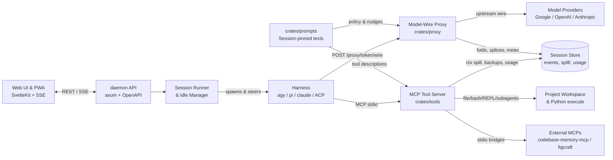
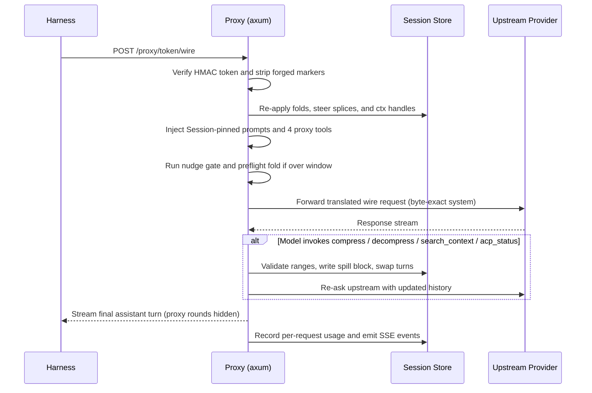
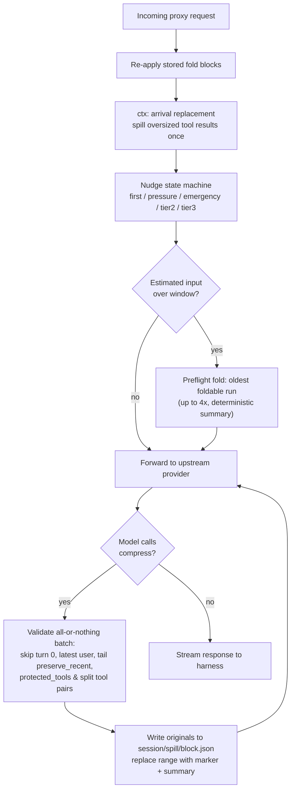
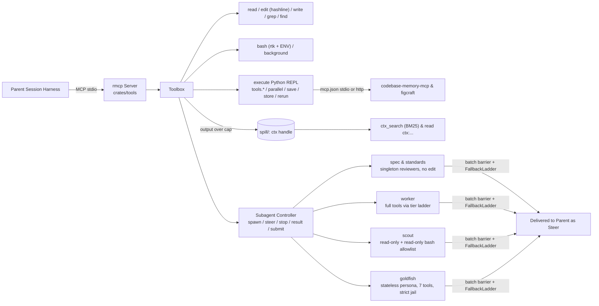
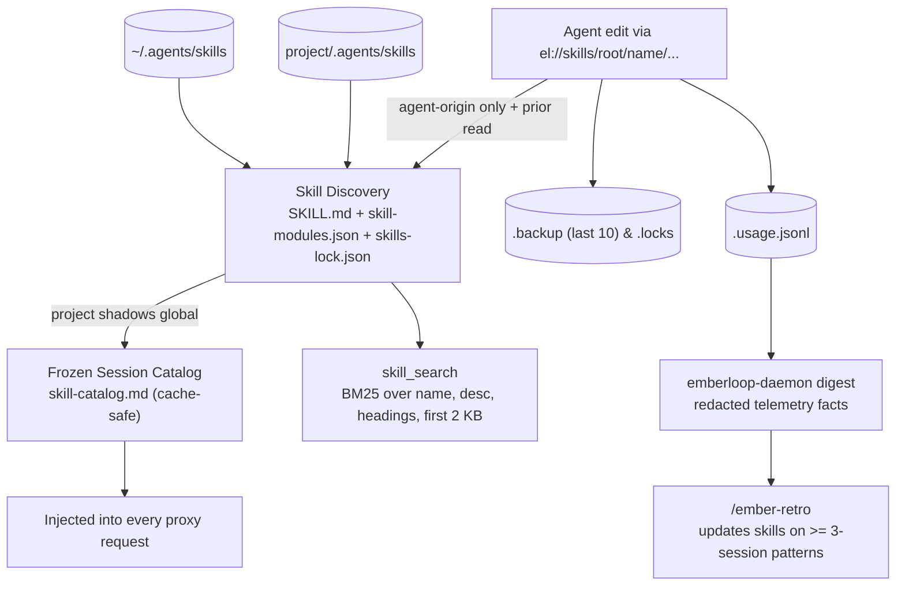

<div align="center">


# 🔥 emberloop-rs

[](https://github.com/ciokyyy/emberloop-rs/actions/workflows/ci.yml)
[](https://github.com/ciokyyy/emberloop-rs/releases/latest)
[](https://www.rust-lang.org/)
[](LICENSE-APACHE)
[](https://github.com/ciokyyy/emberloop-rs/stargazers)

**Local coding-agent daemon in Rust where one proxy owns the model wire.**

[Features](#-features) • [Architecture](#-architecture--diagrams) • [Getting Started](#-getting-started) • [CLI & Usage](#-cli--usage) • [Testing & Development](#-testing--development)

</div>

---

## 👋 Overview

`emberloop-rs` is a local coding-agent daemon written in Rust that serves an embedded SvelteKit UI on loopback, runs Sessions through pluggable agent harnesses (`agy`, `pi`, `claude`, and generic ACP), and routes every model request through one local proxy so context compression, steering, tool policy, prompt pinning, and usage metering live in one place.

Every core capability is owned by one Rust crate. A rule written once in the proxy, tool server, or prompt store applies identically across every harness and model provider without per-agent adapters.

---

## 💡 What This Solves & Why It Matters

Running coding agents directly against providers fragments critical infrastructure across every CLI and SDK:

- **Before:** Each harness invents its own context compaction, drops or mutates steering messages mid-turn, drifts prompts mid-run (breaking provider prompt caches), loses history when you switch models or agents, and exposes inconsistent filesystem/shell tools.
- **After:** `emberloop-rs` sits at the wire boundary. Harnesses run with empty built-in system prompts while the proxy injects Session-pinned policies, enforces billion-context folding and `ctx:` spill handles without breaking prompt caches, re-attaches queued steers byte-identically, sanitizes turns across harness/model switches (`carry`), and gives every harness the exact same `rmcp` tool server.

---

## 🎯 Who It Is For

- **Engineers running long-horizon coding Sessions** across multiple model providers and agent harnesses (`agy`, `pi`, `claude`, ACP) from one self-hosted loopback UI and PWA
- **Teams standardizing agent workflows** via shared skills (`SKILL.md`), goldfish reviewer personas, fallback model ladders, and automated `scripts/check` verification
- **Not for** multi-tenant public SaaS hosting without an authenticating reverse proxy — `emberloop-daemon` assumes a single local operator and binds `127.0.0.1` by default

---

## 📖 Table of Contents

- [👋 Overview](#-overview)
- [💡 What This Solves & Why It Matters](#-what-this-solves--why-it-matters)
- [🎯 Who It Is For](#-who-it-is-for)
- [✨ Features](#-features)
- [🧱 Architecture & Diagrams](#-architecture--diagrams)
- [🚀 Getting Started](#-getting-started)
- [💻 CLI & Usage](#-cli--usage)
- [🔧 Configuration](#-configuration)
- [🔄 Upgrading](#-upgrading)
- [🧪 Testing & Development](#-testing--development)
- [📁 Project Structure](#-project-structure)
- [🧭 Status & Scope](#-status--scope)
- [🤝 Contributing](#-contributing)
- [📜 License](#-license)
- [📧 Support & Security](#-support--security)

---

## ✨ Features

### 🔌 Model-Wire Proxy (`crates/proxy`)

- **Four-wire protocol translation** — Translates Google, OpenAI Chat Completions, OpenAI Responses, and Anthropic wire payloads into one neutral core turn list (`extract_core_contents`) and renders them back (`write_core_contents`) while keeping system/developer items byte-identical
- **Billion-context conversation folding** — Declares and executes `compress`, `decompress`, `search_context`, and `acp_status` on the wire so proxy turns stay invisible to harnesses, driven by a persisted nudge state machine (`first`, `pressure`, `emergency`, `tier2`, `tier3`) and a preflight overflow backstop
- **Oversized output spill (`ctx:`)** — Replaces oversized tool results once at arrival with deterministic `ctx:<id>` placeholders backed by `<session>/spill/` so prompt caches stay intact
- **Byte-identical steering & mid-Session `carry`** — Splices queued steers onto their anchor tool-result turns without re-serializing thought signatures, and sanitizes history (`carry.rs`) when switching harnesses or models mid-Session
- **Prompt pinning & accurate usage metering** — Pins prompt texts and tool descriptions per Session at launch, strips forged proxy markers, and records per-request input/cache usage from each upstream response

### 🔧 MCP Tool Server & Python REPL (`crates/tools`)

- **Anchored file editing & project search** — Serves line-numbered `read` (range paging, `:raw`, images, `ctx:` handles, `el://skills/<name>`, `el://docs/<topic>`), hashline `edit` (including atomic multi-file patches), `write`, and project-jailed `grep` and `find`
- **Shell, background jobs & stateful Python `execute` REPL** — Runs `bash` (with automatic `rtk` output compression when installed, sourced `$EMBERLOOP_ENV_FILE`, and browser discovery for `agent-browser`/`obscura`), `background` (`list`, `read`, `wait`, `stop`), and `execute` (persistent Python REPL bridging `tools.*`, `tools.parallel`, `tools.save`/`run`, `tools.store`/`load`, `tools.rerun`, plus configured `mcp.json` servers over stdio, Streamable HTTP or legacy SSE, such as `codebase-memory-mcp` and `figcraft`)
- **Search & call recovery** — Provides BM25 `ctx_search` over spilled output, `websearch` (Brave, Exa, DeepSeek), BM25 `skill_search`, and `retry_call` to re-run failed tool calls with targeted patches

### 🤖 Pluggable Harnesses & Providers (`crates/harness*`, `crates/core`)

- **Antigravity ACP (`harness-agy`)** — Runs `agy_acp_server.par` with live model and reasoning-effort discovery over ACP
- **pi ACP (`harness-pi`)** — Drives `pi --mode acp` in isolated per-Session `HOME`s over SSE for `opencode-go`, `openai-codex` (ChatGPT OAuth), and 26 bundled API-key providers
- **Claude Code (`harness-claude`)** — Drives `claude` over `stream-json` with OAuth `.credentials.json` rotation sync and `--resume` continuity
- **Generic ACP (`harness-acp`)** — Shared ACP driver supporting live `configure_model` and `thought_level` changes

### 👥 Subagents, Tiers & Fallback Ladders (`crates/api`, `crates/daemon`)

- **Five specialized roles** — `spec` and `standards` singleton reviewers (ticket + starting-point audit, `edit` removed), `worker` (full editing and shell), `scout` (read-only research with `edit`/`write` removed and shell restricted to a read-only allowlist), and `goldfish` (stateless one-shot reviewer with named personas, stripped system context, a 7-tool allowlist, and a strict Project/skills/Session-dir read jail)
- **Tiers, ladders & barrier batches** — Routes `worker`, `scout`, and `goldfish` through abstract tiers (`smol`, `mid`, `top`), retries/escalates along ordered `FallbackLadder`s (`spec_reviewer`, `standards_reviewer`, `subagent_tiers`, `goldfish_tiers`), and synchronizes sibling reports behind `batch` barriers via `spawn`, `steer`, `stop`, `result`, and `submit`

### 📚 Skills, Prompt Store & Retrospective (`crates/prompts`, `crates/daemon`)

- **Skill catalog & modules** — Discovers `SKILL.md` bundles from global (`~/.agents/skills`) and project (`.agents/skills`) roots, freezes `skill-catalog.md` at Session start to preserve prompt caches, groups skills via `skill-modules.json`, tracks downloads in `skills-lock.json`, and guards agent-origin edits via `el://skills/<root>/<name>/...` with 10-version backups and per-skill locks
- **Telemetry digest** — `emberloop-daemon digest` produces secret-redacted Session and skill usage reports (`index.md` + per-Session files) consumed by `/ember-retro`

### 🌐 Embedded Web UI & PWA (`web/`)

- **Live operator console** — Embedded into `emberloop-daemon` via `rust-embed` with live SSE Session streams, collapsible tool/thinking runs, context-ring breakdown, `/cache` prompt-cache analyzer, composer attachments and `/skill` slash expansion, subagent tree/report cards, provider OAuth & API-key settings, usage history, skills viewer/editor, `/design` FigCraft live viewer, External Binaries status monitor (`agy`, `claude`, `pi`, `rtk`, `figcraft`, `codebase-memory-mcp`), and installable PWA Web Push notifications

### 🛠️ Tech Stack

**Backend (Rust Workspace)**

[](https://www.rust-lang.org/)
[](https://tokio.rs/)
[](https://docs.rs/axum/)
[](https://docs.rs/rmcp/)
[](https://docs.rs/utoipa/)
[](https://docs.rs/rust-embed/)

**Frontend (`web/` Embedded PWA)**

[](https://svelte.dev/)
[](https://kit.svelte.dev/)
[](https://tailwindcss.com/)
[](https://bits-ui.com/)
[](https://www.typescriptlang.org/)
[](https://vite.dev/)
[](https://vitest.dev/)

---

## 🧱 Architecture & Diagrams

Four subsystems own almost all behaviour in `emberloop-rs`, each keeping its state in one place:

| Subsystem | Crate | Owns |
| --- | --- | --- |
| **Proxy** | `crates/proxy` | Model wire translation, billion-context folding, steer splices, `carry`, usage metering |
| **Tools** | `crates/tools` | Workspace MCP tools, `execute` Python REPL, path jail, spill store, failed-call store |
| **Skills** | `crates/tools` + `crates/daemon` | `SKILL.md` discovery, frozen catalog, modules, safe `el://skills/` edits, provenance |
| **Prompts** | `crates/prompts` | Every model-facing text under a stable id, overrides, and Session pinning |

### 🌐 1. System Topology & Subsystem Coupling



### 🔌 2. Model-Wire Proxy & Steering Request Lifecycle

Every harness starts with an empty system prompt and talks to `http://127.0.0.1:<port>/proxy/<hex(session_id).hex(hmac)>/<wire_path>`. The proxy authenticates the Session without headers, normalizes the wire payload, applies stored mutations, and hides proxy-only tool rounds from the harness:



### 🧠 3. Billion-Context Compression & `ctx:` Spill Pipeline

Folding is initiated either by the model (`compress`, nudged when growth and thresholds warrant it) or automatically by the preflight overflow backstop when input tokens (`tokens.rs`: CJK = 1 token/char, others = `ceil(n / 4)`) exceed the model window:



### 🔧 4. MCP Tool Server, Python `execute` Bridge & Subagent Orchestration

`emberloop-daemon mcp` exposes the workspace `Toolbox` over `rmcp` stdio so ACP and non-ACP harnesses receive identical capabilities, while `spawn`/`steer`/`stop`/`result`/`submit` coordinate five isolated subagent roles:



### 📚 5. Skills, Prompt Store & Retrospective Loop



Further internal notes live in [docs/architecture.md](docs/architecture.md) and [GLOSSARY.md](GLOSSARY.md).

---

## 🔍 Subsystem Reference

### 🧰 MCP Tools, Proxy Wire Tools & Subagent Matrix

| Surface | Tool | Purpose | `worker` | `scout` | `spec` / `standards` | `goldfish` |
| --- | --- | --- | --- | --- | --- | --- |
| **Proxy wire** | `compress` | Fold turn ranges into spill blocks | Yes | Yes | Yes | No |
| **Proxy wire** | `decompress` | Restore folded block turns | Yes | Yes | Yes | No |
| **Proxy wire** | `search_context` | Search compressed block summaries & turns | Yes | Yes | Yes | No |
| **Proxy wire** | `acp_status` | Inspect context usage & foldable ranges | Yes | Yes | Yes | No |
| **MCP** | `read` | Line-numbered file/URL/`ctx:`/`el://` reader + images | Yes | Yes | Yes | Project/skills/Session jail |
| **MCP** | `edit` | Hashline multi-file patcher | Yes | No | No | No |
| **MCP** | `write` | Create/overwrite file or agent-origin skill | Yes | No | No | No |
| **MCP** | `grep` | Project-jailed regex search (`content`/`files`/`count`/`json`) | Yes | Yes | Yes | Yes |
| **MCP** | `find` | Project-jailed path search (via `tools.find` when `execute` active) | `tools.find` | `tools.find` | `tools.find` | Yes |
| **MCP** | `bash` | Shell with `rtk` rewrite & `$EMBERLOOP_ENV_FILE` | Yes | Read-only allowlist | Yes | No |
| **MCP** | `background` | `list` / `read` / `wait` / `stop` detached commands | Yes | Yes | Yes | No |
| **MCP** | `execute` | Persistent Python REPL bridging `tools.*` & `mcp.json` | Yes | Yes | Yes | No |
| **MCP** | `ctx_search` | BM25 search across spilled output | Yes | Yes | Yes | Yes |
| **MCP** | `websearch` | Web search (Brave, Exa, DeepSeek) | Yes | Yes | Yes | Yes |
| **MCP** | `skill_search` | BM25 search across global + project skills | Yes | Yes | Yes | No |
| **MCP** | `retry_call` | Retry failed `spawn`/`steer`/`write`/`edit` with patches | Yes | Yes | Yes | No |
| **MCP** | `spawn` / `steer` / `stop` / `result` | Manage child subagents & `batch` barriers | Yes | Yes | Yes | No |
| **MCP** | `submit` | Deliver structured `done`/`blocked` report to parent | Subagents | Subagents | Subagents | Yes |

### 🤖 Harnesses & Providers

- **Antigravity ACP (`agy`)** — `agy_acp_server.par` with live model and reasoning-effort discovery
- **Claude Code (`claude`)** — `claude` CLI over `stream-json` with OAuth `.credentials.json` sync and `--resume`
- **Generic ACP (`acp`)** — Any ACP-compatible binary with live model and thought-level selection
- **pi ACP (`pi`)** — Isolated per-Session `HOME` over SSE supporting `opencode-go`, `openai-codex` (ChatGPT OAuth), and 26 API-key providers in `crates/core/src/providers.rs`:

<details>
<summary><strong>All 26 bundled API-key providers + OAuth endpoint in crates/core/src/providers.rs</strong></summary>

| Provider ID | Name | Upstream Base URL |
| --- | --- | --- |
| `anthropic` | Anthropic | `https://api.anthropic.com` |
| `ant-ling` | Ant Ling | `https://api.ant-ling.com/v1` |
| `baseten` | Baseten | `https://inference.baseten.co/v1` |
| `cerebras` | Cerebras | `https://api.cerebras.ai/v1` |
| `deepseek` | DeepSeek | `https://api.deepseek.com` |
| `fireworks` | Fireworks | `https://api.fireworks.ai/inference` |
| `groq` | Groq | `https://api.groq.com/openai/v1` |
| `huggingface` | Hugging Face | `https://router.huggingface.co/v1` |
| `kimi-coding` | Kimi For Coding | `https://api.kimi.com/coding/v1` |
| `minimax` | MiniMax | `https://api.minimax.io/anthropic` |
| `minimax-cn` | MiniMax CN | `https://api.minimaxi.com/anthropic` |
| `mistral` | Mistral | `https://api.mistral.ai` |
| `moonshotai` | Moonshot AI | `https://api.moonshot.ai/v1` |
| `moonshotai-cn` | Moonshot AI CN | `https://api.moonshot.cn/v1` |
| `nvidia` | NVIDIA | `https://integrate.api.nvidia.com/v1` |
| `openai` | OpenAI | `https://api.openai.com/v1` |
| `openrouter` | OpenRouter | `https://openrouter.ai/api/v1` |
| `qwen-token-plan` | Qwen Token Plan | `https://token-plan.ap-southeast-1.maas.aliyuncs.com/compatible-mode/v1` |
| `qwen-token-plan-cn` | Qwen Token Plan CN | `https://token-plan.cn-beijing.maas.aliyuncs.com/compatible-mode/v1` |
| `qwen-token-plan-individual` | Qwen Token Plan Individual | `https://token-plan.ap-southeast-1.maas.aliyuncs.com/compatible-mode/v1` |
| `together` | Together | `https://api.together.ai/v1` |
| `vercel-ai-gateway` | Vercel AI Gateway | `https://ai-gateway.vercel.sh` |
| `xai` | xAI | `https://api.x.ai/v1` |
| `xiaomi` | Xiaomi | `https://api.xiaomimimo.com/v1` |
| `xiaomi-token-plan-ams` / `-cn` / `-sgp` | Xiaomi Token Plan (AMS / CN / SGP) | `https://token-plan-{ams,cn,sgp}.xiaomimimo.com/v1` |
| `zai` / `zai-coding-cn` | Z.AI / Z.AI Coding CN | `https://api.z.ai/api/coding/paas/v4` / `https://open.bigmodel.cn/api/coding/paas/v4` |
| `openai-codex` *(OAuth)* | ChatGPT | `https://chatgpt.com/backend-api` |

</details>

### 📡 HTTP, SSE & Proxy Surface

<details>
<summary><strong>Daemon endpoints exposed by crates/api and crates/proxy (also served at /openapi.json)</strong></summary>

| Group | Endpoints |
| --- | --- |
| **Projects & Design** | `GET/POST /api/projects`, `POST /api/projects/clone`, `GET/DELETE /api/projects/{id}`, `GET /api/projects/{id}/design`, `GET /api/figcraft/live/` |
| **Sessions & Subagents** | `GET/POST /api/sessions`, `GET/DELETE/PATCH /api/sessions/{id}`, `POST /api/sessions/{id}/prompt`, `/steer`, `/cancel`, `/subagents`, `GET /api/sessions/{id}/file`, `/events` (SSE), `/history`, `/usage` |
| **Skills, Personas & Prompts** | `GET /api/personas`, `GET /api/skills`, `GET /api/skills/{name}`, `GET /api/skills/{name}/history`, `GET /api/prompts`, `GET/PUT/DELETE /api/prompts/{id}` |
| **Settings, Models & Status** | `GET/PUT /api/settings`, `GET /api/tool-keys`, `PUT /api/tool-keys/{name}`, `GET /api/models`, `POST /api/models/refresh`, `GET /api/version`, `GET /api/status/system`, `/binaries`, `/tokens`, `/sessions/events` |
| **Proxy & Health** | `ANY /proxy/{token}/{*rest}`, `GET /health`, `GET /openapi.json` |

</details>

---

## 🚀 Getting Started

### 📋 Prerequisites

Ensure these tools are installed before building:

- [Rust](https://www.rust-lang.org/) (current stable) and `cargo`
- [Bun](https://bun.sh/) 1.x (web workspace uses Bun exclusively)
- `git`
- Python 3 (for the `execute` REPL bridge)
- At least one agent harness binary (`agy`, `pi`, `claude`, or an ACP agent) on `PATH` or configured via env var
- Optional companion tools monitored on **Status -> External Binaries**: `rtk`, `figcraft` (`scripts/install-figcraft`), and `codebase-memory-mcp`

### 📦 Installation

#### 1. Clone the repository

```bash
git clone https://github.com/ciokyyy/emberloop-rs.git
cd emberloop-rs
```

#### 2. Build the embedded web UI

`emberloop-daemon` embeds `web/build` at compile time via `rust-embed`, so build the frontend first:

```bash
cd web && bun install --frozen-lockfile && bun run build && cd ..
```

#### 3. Build the daemon binary

```bash
cargo build --release -p emberloop-daemon
```

Success produces `target/release/emberloop-daemon`.

#### 4. Start the daemon and verify

```bash
./target/release/emberloop-daemon
```

On success it binds `127.0.0.1:3000` quietly; open <http://127.0.0.1:3000> in your browser (or check `curl http://127.0.0.1:3000/health` returns `ok`), then configure your provider keys or OAuth login in **Providers**.

---

## 💻 CLI & Usage

### ⚡ Daemon flags

| Flag | Default | Meaning |
| --- | --- | --- |
| `--port` | `3000` | HTTP + SSE listening port |
| `--host` | `127.0.0.1` | Bind address (non-loopback requires `--allow-remote`) |
| `--allow-remote` | `false` | Allow binding a non-loopback `--host` |
| `--base-url` | none (`EMBERLOOP_BASE_URL`) | Origin a browser reaches the daemon at, for share links and the design view; saved into `settings.json` once |
| `--data-root` | `~/.local/share/emberloop-rs` | Projects, Sessions, `settings.json`, models, releases, transcripts |
| `--config-root` | `~/.config/emberloop-rs` | Provider keys, `tool-keys.json`, `mcp.json`, runtime `env`, prompt overrides |
| `--upstream` | none | Upstream HTTP proxy for outbound provider requests |
| `--idle-timeout-minutes` | harness default | Shut down idle harness processes; next prompt resumes seamlessly |

### 📦 Subcommands

```bash
# Serve one Session's workspace tools over MCP stdio
emberloop-daemon mcp --root <PROJECT_DIR> --spill <SPILL_DIR> [--global-skills <DIR>]

# Generate LLM-free Session and skill telemetry facts (consumed by /ember-retro)
emberloop-daemon digest [--since <UNIX_MS>] [--limit <N>] [--session <ID>] [--out <DIR>]

# Check, install, or roll back daemon releases
emberloop-daemon update [--check] [--rollback] [--manifest <URL>] [--file <PATH>] [--major] [--next-version]
```

---

## 🔧 Configuration

Operator configuration lives under `--data-root` and `--config-root`, never in this repository.

- **`<data-root>/settings.json`** — `default_model`, `title_generation`, `title_model`, `spec_reviewer` / `standards_reviewer` / `subagent_tiers` / `goldfish_tiers` fallback ladders, `ponytail_default_level` (`full`), `proxy_compression` (`true`), `max_context_limit` (`20`), `emergency_threshold_percent` (`25`), `preserve_recent_messages` (`4`), `min_pressure_benefit_tokens` (`0` = `max(5000, window / 100)`), `protected_tools`, `tier2_trigger` (`1000`), `tier3_trigger` (`2000`), `ctx_spill_enabled` (`false`), and `base_url` (empty means unset)
- **`base_url`** — The origin this browser uses to reach the daemon (`https://box.tailnet.ts.net`), for share links and the design view's WebSocket origin. `--base-url` or `EMBERLOOP_BASE_URL` fills it once when `settings.json` holds none; the Settings screen edits it later, and a stored value always wins. Use a tailnet-only address: a public address, such as a Tailscale Funnel, lets anyone who reaches it drive the design view's loopback FigCraft server.
- **`<config-root>/keys.json` & `tool-keys.json`** — Provider API keys and tool keys (`BRAVE_API_KEY`, `EXA_API_KEY`, `JINA_API_KEY`) saved with `0600` permissions
- **`<config-root>/mcp.json`** — Extra MCP servers bridged into Python `execute` as `tools.<server>.<tool>(...)` (`codebase-memory-mcp` as `graph` and `figcraft` auto-register when absent). Each entry gives exactly one of `command` (stdio) or `url` (Streamable HTTP, or legacy HTTP+SSE with `"transport": "sse"`), plus optional `include`/`exclude`/`enabled`/`summary`/`project`/`transport`; a `url` entry may not carry `args` or `setup`, and its `headers` are sent on every request. An entry without `gated` is global; `"gated": true` hides it unless the Session's Project lists an enabled tool with the server's name, so a Craft app stays out of every other Project:

  ```json
  {
    "mcpServers": {
      "jobs": {
        "url": "https://box.tailnet.ts.net/mcp",
        "headers": { "Authorization": "Bearer <token>" },
        "gated": true
      }
    }
  }
  ```
- **`<config-root>/env`** — Shell file sourced before every `bash` and `execute` call (`$EMBERLOOP_ENV_FILE`) so tool paths and env updates apply without restarting the daemon
- **`<config-root>/prompts/<id>.md`** — File overrides for any prompt id in `crates/prompts` (Session-pinned at launch so active Sessions stay cache-consistent)
- **Skills & personas discovery** — Skills resolve from `<project>/.agents/skills` then `~/.agents/skills`; goldfish personas (`*.md`) resolve in order: `<project>/.agents/agents/*.md`, `<project>/.agents/skills/*/agents/*.md`, `<global-skills>/../agents/*.md`, `<global-skills>/*/agents/*.md`

Environment variables:

- `EMBERLOOP_AGY_BIN`, `EMBERLOOP_PI_BIN`, `EMBERLOOP_CLAUDE_BIN` — Override harness executable paths
- `EMBERLOOP_HOME`, `EMBERLOOP_LAUNCHER`, `EMBERLOOP_UPDATE_URL` — Override release directory, launcher symlink, and update manifest URL
- `EMBERLOOP_PROXY_DUMP` — Directory path to dump incoming, processed, and wire payloads for proxy debugging
- `EMBERLOOP_BASE_URL` — Same as `--base-url`; seeds `settings.json` when it holds no `base_url`

---

## 🔄 Upgrading

```bash
emberloop-daemon update            # install newest GitHub release
emberloop-daemon update --check    # print available version without installing
emberloop-daemon update --rollback # revert to previous staged release
```

Releases stage under `<data-root>/releases/<version>/` behind an atomic `current` symlink so a running binary is never overwritten in place and active Sessions resume automatically after restart.

To build and stage a release locally:

```bash
scripts/release            # build release binary + latest.json in target/release-dist
scripts/release --publish  # upload binary + latest.json to GitHub Releases
```

---

## 🧪 Testing & Development

Run the daemon against an isolated scratch root while developing:

```bash
cargo run -p emberloop-daemon -- --data-root /tmp/emberloop-dev
```

Run the repository verification suite before opening a PR or shipping:

```bash
scripts/check          # full CI suite: fmt, deny, machete, clippy, openapi, icons, wire-diff, web, nextest, doctests
scripts/check-changed  # only stages touched by the current working tree
```

`scripts/check` writes per-stage logs to `target/<stage>.log`, writes `target/<stage>.failed` on failure, enforces stage budgets from `scripts/check-budget.tsv`, and mirrors [.github/workflows/ci.yml](.github/workflows/ci.yml).

> **Note:** The `openapi` stage regenerates [openapi.json](openapi.json) and `web/src/lib/api/schema.d.ts`, and `generated` fails if either has uncommitted diffs. Read [AGENTS.md](AGENTS.md) and any crate-level `AGENTS.md` before changing contracts, and update them in the same commit.

### 🩺 Troubleshooting

| Symptom | Likely Cause | Fix |
| --- | --- | --- |
| Non-loopback `--host` rejected at startup | Loopback safety guard | Pass `--allow-remote` only on trusted private networks |
| Harness or companion binary missing | Executable not on `PATH` | Inspect **Status -> External Binaries** in UI or set `EMBERLOOP_AGY_BIN` / `EMBERLOOP_PI_BIN` / `EMBERLOOP_CLAUDE_BIN` |
| Prompt cache hit rate drops unexpectedly | Mid-run prompt override or unpinned system text | Inspect `/cache` in the UI and set `EMBERLOOP_PROXY_DUMP=<dir>` to compare incoming vs. wire payloads |
| `scripts/check` stage fails | Lint, OpenAPI drift, web test, or Rust test failure | Read `target/<stage>.log` for the stage named by `target/<stage>.failed` |

---

## 📁 Project Structure

```text
emberloop-rs/
├── crates/
│   ├── api/             # REST + SSE routes, subagent recovery/submit, OpenAPI schema
│   ├── core/            # Context tree, EventBus, IDs, steer queues, provider registry
│   ├── daemon/          # CLI, composition root, Session runner, digest, self-updater
│   ├── harness/         # Generic Harness & HarnessSession traits
│   ├── harness-acp/     # Shared ACP session driver
│   ├── harness-agy/     # Antigravity ACP harness
│   ├── harness-claude/  # Claude Code stream-json harness
│   ├── harness-pi/      # pi-rust ACP harness and model catalogue reader
│   ├── prompts/         # Embedded model-facing texts, overrides, Session pinning
│   ├── proxy/           # 4-wire proxy, compression, nudge, carry, splices, usage meter
│   ├── spike/           # Excluded prototype crate
│   ├── store/           # Project/Session persistence, segmented event logs, blobs
│   └── tools/           # rmcp server, Python execute bridge, jail, spill & persona stores
├── web/                 # SvelteKit 3 + Svelte 5 + Tailwind v4 + shadcn-svelte embedded PWA
├── docs/                # Architecture documentation and brand logo
├── specs/               # Design and phase specification documents
├── scripts/             # check, check-changed, release, icon & wire-diff scripts
├── vendor/              # Vendored ember workflow skills
├── Cargo.toml           # Workspace manifest and strict clippy lints
└── openapi.json         # Generated OpenAPI specification
```

---

## 🧭 Status & Scope

**Active pre-1.0 development.** CLI flags, HTTP/SSE routes, and the on-disk `<data-root>` layout evolve between releases. Releases are versioned snapshots rather than backwards-compatibility guarantees; pin a release tag if you need the storage layout to remain fixed.

---

## 🤝 Contributing

See [CONTRIBUTING.md](CONTRIBUTING.md) for workflow, commit format (`type(scope): summary`), testing expectations, and PR guidelines, and [CODE_OF_CONDUCT.md](CODE_OF_CONDUCT.md) for community standards.

---

## 📜 License

Dual-licensed under either of:

- Apache License, Version 2.0 ([LICENSE-APACHE](LICENSE-APACHE))
- MIT license ([LICENSE-MIT](LICENSE-MIT))

at your option. Unless you state otherwise, any contribution you submit for inclusion in this project is licensed under the same terms.

---

## 📧 Support & Security

- **Questions & bug reports:** Read [SUPPORT.md](SUPPORT.md) before opening an issue.
- **Security vulnerabilities:** Follow [SECURITY.md](SECURITY.md) and use GitHub private vulnerability reporting — never post vulnerabilities in public issues.

---

<div align="center">

**[⬆ Back to Top](#-emberloop-rs)**

</div>
