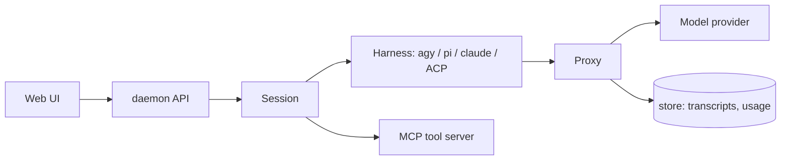

<p align="center">
  
</p>

<h1 align="center">emberloop-rs</h1>

<p align="center">Run coding-agent Sessions from a local daemon, with one proxy that owns the model wire.</p>

emberloop-rs is the Rust implementation of Emberloop. A single daemon serves a
browser UI on loopback, runs agent Sessions through pluggable harnesses, and
proxies every model request so that context compression, steering, tool policy
and usage metering happen in one place instead of in each harness.

Every capability is owned by one crate, so a behaviour is declared once and
read by every harness instead of being re-implemented per agent.

## Status

Pre-1.0. The CLI flags, the HTTP API and the on-disk layout change between
releases. A tag is a snapshot, not a stability promise; pin one if you need the
layout to stay put.

## What it does

- **One proxy for every model call.** `crates/proxy` translates between wire
  formats, injects the operating policy, compresses long conversations, steers
  running Sessions, and records usage. Harnesses never talk to a provider
  directly.
- **Tools over MCP.** `crates/tools` serves one Session's tools over MCP stdio:
  file reads and edits, shell, background processes, search, and the skills
  catalog.
- **Harness adapters.** `crates/harness`, `harness-agy`, `harness-pi`,
  `harness-claude` and `harness-acp` drive an agent CLI over ACP or its own
  protocol, so the same Session surface works across agents.
- **Sessions and subagents.** `crates/daemon` owns Session lifecycle,
  persistence, idle reaping and reviewer subagents; `crates/store` keeps the
  transcripts and blobs on disk.
- **Web UI.** `web/` is a SvelteKit app (Tailwind v4, shadcn-svelte) built into
  `web/build` and embedded in the daemon binary.



## Requirements

- Rust (current stable) and `cargo`
- [bun](https://bun.sh) 1.x, to build the web bundle
- `git`
- At least one harness CLI on `PATH` (`pi`, `claude`, or an ACP-compatible agent)
  if you want to run Sessions

## Build

The daemon embeds `web/build` at compile time, so build the web bundle first:

```bash
git clone https://github.com/ciokyyy/emberloop-rs
cd emberloop-rs
cd web && bun install --frozen-lockfile && bun run build && cd ..
cargo build --release -p emberloop-daemon
```

The binary is `target/release/emberloop-daemon`.

## Run

```bash
./target/release/emberloop-daemon
```

It binds `127.0.0.1:3000` and prints nothing on success; open
<http://127.0.0.1:3000>. A non-loopback `--host` is refused unless you also pass
`--allow-remote`.

| Flag | Default | Meaning |
| --- | --- | --- |
| `--port` | `3000` | HTTP port |
| `--host` | `127.0.0.1` | Bind address; loopback only unless `--allow-remote` |
| `--data-root` | `~/.local/share/emberloop-rs` | Sessions, projects, releases, transcripts |
| `--config-root` | `~/.config/emberloop-rs` | Provider keys, model catalogue, prompts, MCP config |
| `--upstream` | none | Upstream proxy for provider requests |
| `--idle-timeout-minutes` | harness default | Close an idle Session's harness; it resumes on the next message |

Model providers, API keys and per-model settings are configured in the web UI
(Settings). Keys are stored under `--config-root`, never in this repository.

## Upgrade

```bash
emberloop-daemon update            # install the newest GitHub release
emberloop-daemon update --check    # report the available version only
emberloop-daemon update --rollback # go back to the previous release
```

`scripts/release` builds a release and writes the binary plus `latest.json`; add
`--publish` to upload both to GitHub Releases.

## Development

```bash
scripts/check          # the full check: fmt, deny, machete, clippy, openapi, web, nextest, doctests
scripts/check-changed  # only what the working tree touched
```

The check must pass unchanged before a change is done; CI runs the same
commands. `scripts/check` writes per-stage logs to `target/<stage>.log` and
enforces per-stage time budgets from `scripts/check-budget.tsv`.

Contract docs live in the `AGENTS.md` files: read the root one and every
`AGENTS.md` on the path to the code you touch, and update them in the same
change when a contract moves.

## Layout

| Path | Contents |
| --- | --- |
| `crates/proxy` | model-wire proxy: translation, compression, steering, usage |
| `crates/tools` | MCP tool server |
| `crates/harness*` | harness adapters (agy, pi, claude, ACP) |
| `crates/daemon` | HTTP + SSE API, Session runner, web asset embedding |
| `crates/api` | shared API types and the OpenAPI document |
| `crates/store` | transcript and blob storage |
| `crates/core` | shared types |
| `web` | SvelteKit UI, built into `web/build` |
| `specs` | specification documents per phase |
| `scripts` | `check`, `check-changed`, `release` |

## Contributing

See [CONTRIBUTING.md](CONTRIBUTING.md). Questions and bug reports go through
[SUPPORT.md](SUPPORT.md); vulnerabilities through [SECURITY.md](SECURITY.md),
never a public issue.

## License

Dual-licensed under either of

- Apache License, Version 2.0 ([LICENSE-APACHE](LICENSE-APACHE))
- MIT license ([LICENSE-MIT](LICENSE-MIT))

at your option. Unless you state otherwise, any contribution you submit for
inclusion in this project is licensed under the same terms.
