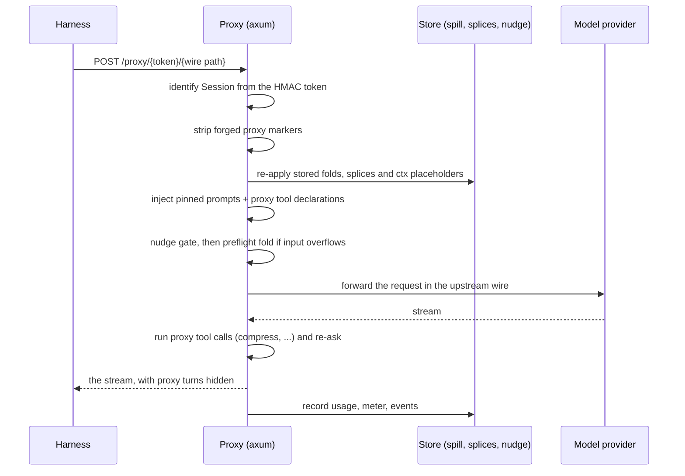
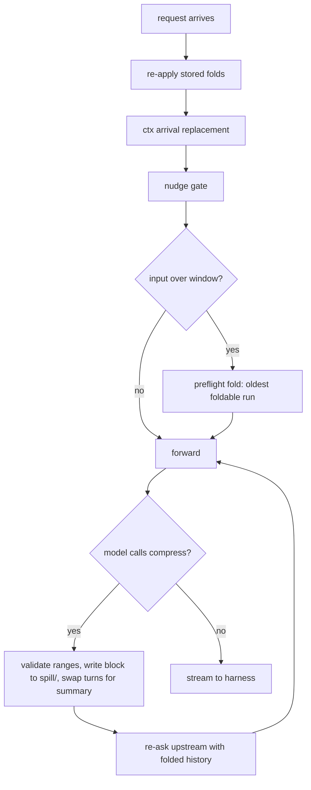
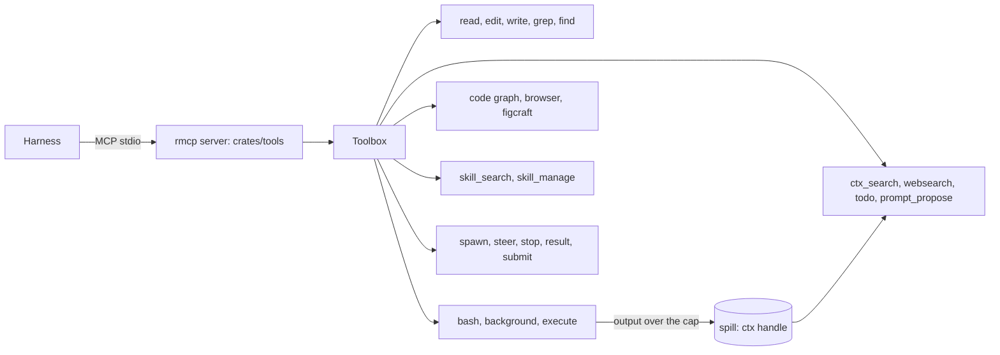
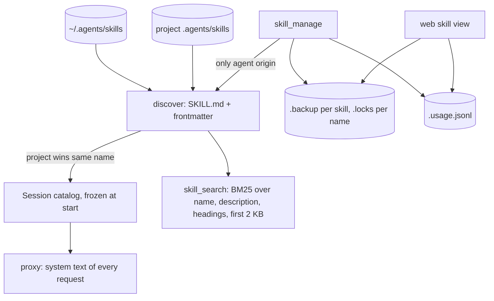
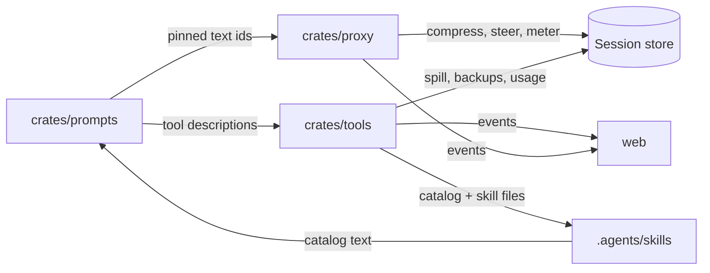

# Architecture

Four subsystems carry almost all of Emberloop's behaviour, and each owns its
state in one place:

| Subsystem | Crate | Owns |
| --- | --- | --- |
| Proxy | `crates/proxy` | the model wire, compression, steering, usage |
| Tools | `crates/tools` | the workspace tools, served over MCP |
| Skills | `crates/tools` + `crates/daemon` | discovery, catalog, edits, provenance |
| Prompts | `crates/prompts` | every model-facing text, and its id |

A harness starts, and the proxy immediately becomes the only thing between it
and a provider. That is why a behaviour said once here reaches agy, pi, claude
and every ACP agent without an adapter change.

## The proxy

- **Routing by Session token.** The path carries `hex(session_id).hex(hmac)`;
  the proxy verifies it with a secret generated once per daemon run, so no
  header maps a request to a Session. `crates/proxy/src/token.rs`.
- **Wire translation.** `WireKind` is one of Google, OpenAI Chat, OpenAI
  Responses or Anthropic, picked from the path. Internally every conversation
  becomes a neutral list of turns (`extract_core_contents`), the proxy's work
  happens there, and `write_core_contents` renders it back in the wire's own
  shape. System and developer items are written back byte for byte.
- **Policy and tool declarations.** `crates/prompts` holds every model-facing
  text under a stable id, with an embedded default and an optional override in
  `<config root>/prompts/<id>.md`. A Session pins its texts at start, so an
  override never changes a running Session. The proxy appends that text
  (`wire::inject_prompts_for_wire`) and the proxy's own tool declarations
  (`wire::inject_tools_for_wire`); harnesses are configured with an empty
  system prompt of their own.
- **Steering.** A queued steer is stored as a splice and re-attached to the
  tool-result turn it belongs to, byte-identically, on every later request. A
  splice is keyed by that turn's id and dropped when the harness drops the
  anchor. Nothing is re-serialised, so thought signatures and other opaque
  fields survive.
- **Carry.** Switching harness or model keeps the Session: `carry.rs` sanitises
  the stored turns (drops `_raw`, opaque parts and empty text, merges same-role
  neighbours) and writes them in the new wire's shape.
- **Usage.** Every response records usage from the request's own input count,
  not a running sum, and publishes events the web UI reads.
- **Skill review.** After a final answer, `review.rs` replays the request it just
  sent plus a review prompt as a separate, non-streaming conversation, and runs
  the model's tool calls through the daemon's executor. Nothing of it reaches the
  harness or the Session history.

## Compression: the billion-context backend

Folding is the model's decision. The proxy declares `compress`, `decompress`,
`search_context` and `acp_status` on the wire and **runs them itself**: the
harness never sees a proxy tool call, and the model's fold request never reaches
the harness. Thresholds only nudge the model; the one automatic fold is the
preflight backstop described below.

**A fold is a stored block.** `compress(start, end, summary, topic)` validates
every range against the history as it is now, then replaces the range with one
summary turn. Validation is strict: a batch is all or nothing, turn 0 never
folds, the latest user message is never folded, protected content ends a run,
`preserve_recent_messages` (default 3) turns at the tail never fold, and a
tool call whose result would land outside the range is rejected because the
upstream would reject the split pair. The summary text is the model's; the
originals go to `<session>/spill/<block id>.json` and the visible turn keeps a
deterministic marker line, `📦 [acp] Compressed turns 12–40 into block b3`,
which `marker.rs` builds and matches in one place.

`decompress(block)` puts the original turns back. `search_context(query)` scores
the stored blocks and returns hits with a snippet; the summary is the only
record of a folded range, so the model is told to search before restoring.

**Two ways a fold starts.**

1. The model calls `compress`, either because it decided to or because a nudge
   asked. `nudge.rs` is a pure state machine persisted to `nudge.json`:
   - **first** fires at `max(min(75000, window / 2), window / 10)` once there
     is compressible mass, because a fold restarts the provider cache from its
     first turn;
   - **pressure** fires at `max_context_limit` (75% by default) and
     **emergency** at `emergency_threshold_percent` (95%); both win over the
     first nudge and need a benefit of at least `max(5000, window / 100)` tokens;
   - **tier2**/**tier3** fire once when the active block count reaches 1000 and
     2000, while under pressure;
   - after a successful fold the gate stays shut, so the next nudge waits for
     50000 tokens of growth instead of firing on every step.

   The token count is a local estimate (`tokens.rs`): each CJK character is one
   token and the rest count `ceil(n / 4)`. Nudge timing, preflight folds, the
   tokens a fold saved and the context breakdown all read the same function, so
   they agree.
2. **Preflight**, the reference's backstop: if the request's own input exceeds
   the window, the proxy folds the oldest foldable run before forwarding, up to
   four times, and writes the summary itself. The model did not choose this
   fold, but the block and its spill file look like any other, so
   `decompress` restores it.

**Where it comes from.** The design follows the `billion-context` npm package
(its binary is `bili`), version 0.1.212, which is where the term and the
configuration names come from: `maxContextLimit` 75%, `emergencyThresholdPercent`
95%, `minCompressRange` 5000, `nudgeGrowthTokens` 50000, `maxEstimateHoldRounds`
2, `compress.preserveRecentMessages`, `compress.protectedTools`, and the
`defaultCountTokens` rule in its `kernel/src/tokenize.ts` (CJK one token per
character, otherwise `ceil(n / 4)`). Its oversized-result replacement (`CCR`,
`kernel/src/ccr.ts`) is the model for `ctx.rs`: the original is stored in the
spill dir and the turn keeps a placeholder naming a `ctx:` handle that `read` and
`ctx_search` page back, computed once so the prompt cache stays valid.

Two deviations are this project's own: the first nudge threshold follows the
window rather than a fixed number, and phase 1 implements the backend natively
in Rust (`Compressor` trait, `NativeCompressor`) instead of supervising a `bili`
process. A proxy-backed compressor that implements the same trait is a later,
optional backend. Parity is checked by golden fixtures taken from the
reference's own tests rather than by documentation.

## Tools

`crates/tools/src/mcp.rs` advertises the workspace tools over `rmcp` and
dispatches calls into a `Toolbox`. Tool descriptions are not compiled strings:
they are prompt-store entries (`tool.<name>.description`), so the web UI can
rewrite one and the next Session's declarations carry it.

- **Files and shell.** `read` returns numbered lines and records them for the
  edit tool's anchors; `edit` takes a hashline patch against the view a read
  produced; `write` creates new files; `grep` and `find` search content and
  paths; `bash` runs a shell; `background` starts and reads long processes. Every
  path a tool touches is resolved inside the project root after symlinks
  (`jail.rs`).
- **`execute`** runs one Python script that calls the tools as functions, so a
  batch of reads or a loop costs one turn. It reaches the code graph
  (`graph.rs`) and the other tools through the same `Toolbox`.
- **Large output** spills to a `ctx:` handle instead of the context window;
  `ctx_search` ranks the spilled text with BM25 and `read ctx:<id>:<start>-<end>`
  pages it.
- **Subagents** use `spawn`, `steer`, `stop`, `result` and `submit`; the daemon
  owns their Sessions, and `crates/proxy/src/review.rs` runs the background
  skill review through the same executor.
- **Hosts.** The daemon serves the tools over MCP stdio (`emberloop-daemon mcp`)
  and `crates/daemon` builds the same `Toolbox` for the reviewer fork, so a
  harness that speaks ACP and one that speaks MCP configuration reach identical
  tools.

The proxy's four tools are separate from this server: they are declared on the
model wire, dispatched inside the proxy, and never reach the harness.

## Skills

- **Discovery.** `skills.rs` reads every directory whose `SKILL.md` opens with
  frontmatter naming it (`name`, `description`, optional `metadata.origin`). A
  project skill wins over a global skill of the same name; a malformed skill is
  skipped with a warning so one bad file hides no other.
- **Frozen catalog.** At Session start the daemon writes `skill-catalog.md` into
  the Session dir from the `skill.catalog` prompt and the discovered lines
  (`runner.rs::freeze_catalog`). The proxy appends that text to every request, so
  a skill created mid-Session is readable by path but appears in the catalog of
  the next Session only. This is deliberate: the catalog is part of the Session's
  pinned prompt, and changing it mid-run would drop the prompt cache.
- **Search.** `skill_search` ranks with BM25 over the name, description, body
  headings and the first 2048 bytes of the body; descriptions are clipped to 150
  characters in a hit, and the limit defaults to 5 with a cap of 20.
- **Editing.** `skill_manage` applies an ordered list of ops (`create`, `patch`,
  `write_file`, `remove_file`) atomically, refuses to touch human or downloaded
  skills, keeps the newest 10 backups per skill, locks one skill name at a time,
  and requires that the file be read earlier in the Session before a patch or a
  write. Supporting files may sit only under `references/`, `templates/`,
  `scripts/` or `assets/`; `SKILL.md` is capped at 100000 characters and a
  supporting file at 1 MiB.
- **Provenance.** `.agents/skills` plus `skills-lock.json` record every
  downloaded skill's source, path, hash and install mode, so an update is a
  re-install and a diff, not a silent overwrite.

## How the four fit together

The prompt store is the seam: policy, tool descriptions, nudge bodies, reviewer
prompts and the skill catalog are all entries with an id, and the proxy and the
tool server read them at Session start. That is why a text fix lands once and
reaches both the wire and the MCP surface.

## Diagrams

The diagrams above are Mermaid and render on GitHub. They describe committed
behaviour: when a default changes, the table or number in this file changes in
the same commit.
